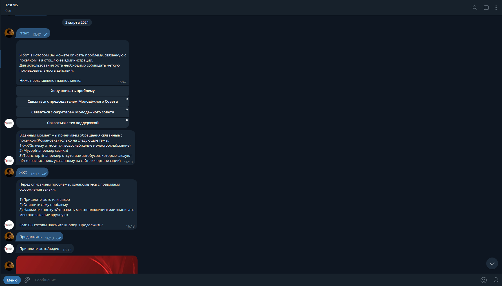

# Telegram-бот для обращений жителей

Бот принимает обращения жителей посёлка и передаёт их администраторам Молодёжного совета. Проект разработан для Молодёжного совета Романовского поселения (грантовый проект). Сейчас бот остановлен, код выложен как пример работы.



## Что умеет

- главное меню: описать проблему, связаться с председателем, секретарём и техподдержкой;
- выбор темы обращения: ЖКХ, мусор, транспорт (или своя тема);
- приём фото или видео к обращению, текст обращения;
- местоположение: отправка геопозиции или ввод адреса вручную; адрес по координатам определяется через Яндекс Геокодер;
- подтверждение перед отправкой, присвоение номера обращению;
- команда `/admin`: администратор отвечает жителю по ID пользователя и номеру обращения;
- у каждого жителя свой черновик обращения, одновременные диалоги не мешают друг другу;
- обращения приходят всем администраторам из `ADMIN_IDS`, пользователи хранятся в SQLite.

## Стек

Python 3, pyTelegramBotAPI (telebot), requests, SQLite, Яндекс Геокодер API.

## Запуск

```bash
pip install -r requirements.txt
cp config.example.py config.py   # впишите токен, ключ геокодера, ADMIN_IDS и ссылки
python main.py
```

Токен выдаёт @BotFather, ключ геокодера создаётся в кабинете разработчика Яндекса.
Файл `config.py` и база `users.db` в репозиторий не добавляются.
